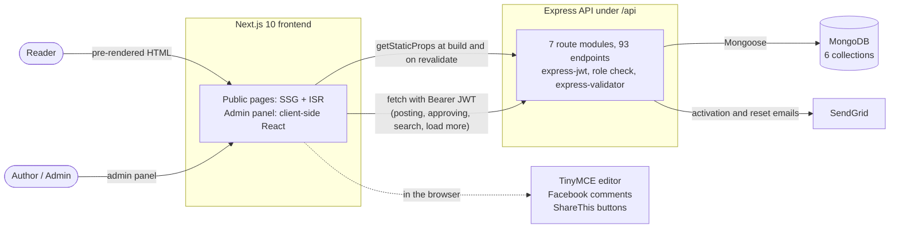
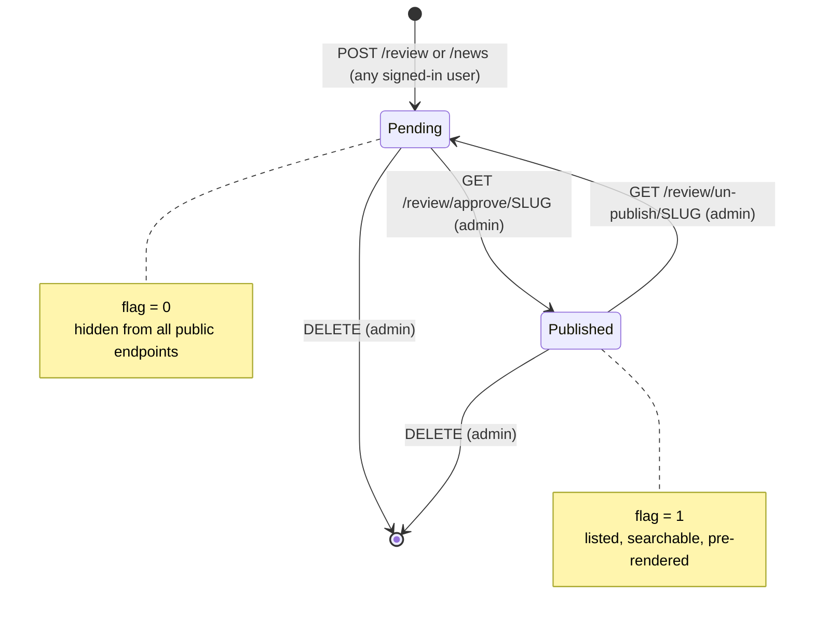
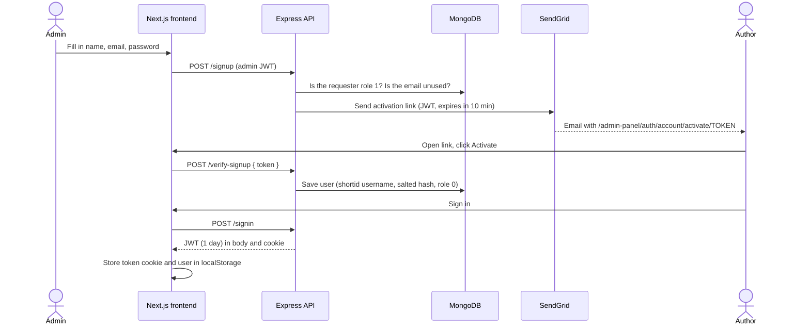
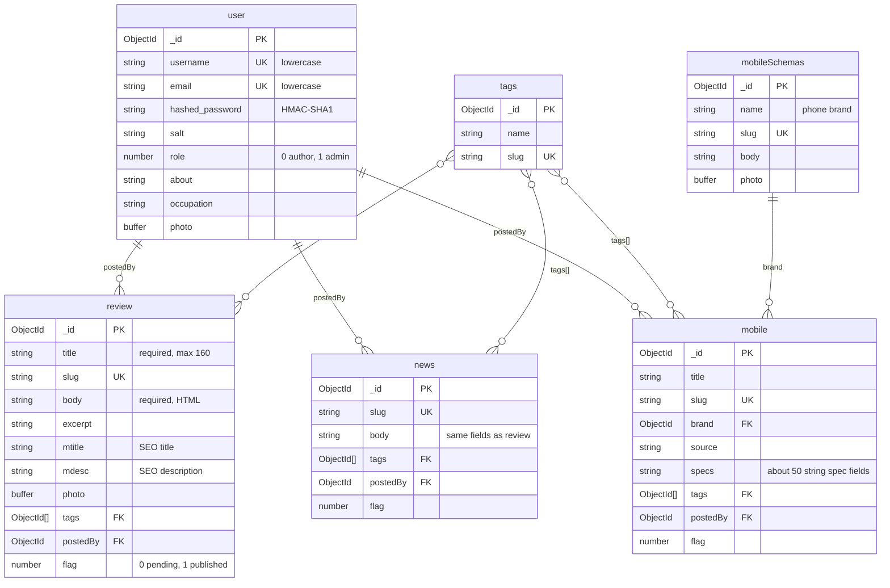

# Multi-User Blog (SEOBLOG)

A multi-author content site for mobile-phone reviews, tech news and a phone specification directory. Authors write reviews and news posts, which stay unpublished until an admin approves them. I built it as a learning project during my Bachelor of IT at Victoria University. Per git history, the code was written between **2020-11-14 and 2021-02-20**: 17 commits, all by me. The only later commit is a 2024 README edit. It has not been maintained since.

The backend is an Express REST API over MongoDB (Mongoose). The frontend is a Next.js 10 app that pre-renders public pages with `getStaticProps`, so search engines receive fully rendered HTML with meta tags.

## By the numbers

All figures are measured from this repo. Counts exclude `node_modules`, `.next` and lock files.

| | |
|---|---|
| Development window | 2020-11-14 → 2021-02-20 (98 days, commits on 15 distinct days, 16 code commits) |
| Backend | 26 JS files, 4,940 lines · 7 route modules · **93 REST endpoints** (62 GET, 19 POST, 7 PUT, 5 DELETE) · 23 require a JWT, 16 of those admin-only |
| Database | 6 MongoDB collections · 7 unique indexes · phone schema has 63 field paths |
| Frontend | 41 Next.js pages · 34 components · 86 JS files, 22,912 lines · 17 CSS files, 8,344 lines |
| Build | 72 pages pre-rendered at build time (with sample data) · 103 kB shared first-load JS |
| Tests (added 2026) | **42 API tests: 36 pass, 6 known issues tracked as `todo`, 0 failures** across 4 runs, ~0.7 s per run |
| Lighthouse (added 2026, local build, mobile) | SEO **100** on all 4 pages tested · Accessibility 80–87 · Best Practices 75–96 · Performance 69–73 |

## Tech stack (as used in code)

- **Backend:** Node.js, Express 4.17, Mongoose 5.9, express-jwt / jsonwebtoken (auth), express-validator, formidable (multipart uploads), SendGrid (emails), slugify, string-strip-html, lodash, shortid, morgan
- **Frontend:** Next.js 10, React 17, reactstrap + Bootstrap 4 CSS (CDN), CSS Modules, TinyMCE editor, isomorphic-fetch, js-cookie, moment, react-icons, react-render-html, react-facebook (comments), sharethis-reactjs (share buttons)
- **Database:** MongoDB
- Installed but never imported: `mdbreact`, `react-bootstrap`, `react-share`, `styled-components`, and the `bootstrap` npm package (Bootstrap CSS loads from a CDN). **Redux is not used.**

## Architecture



## Features

- **Posts:** reviews and news posts, written in a rich-text editor (TinyMCE) and stored as HTML, each with one required featured image (≤1 MB) and at least one tag. The slug, excerpt, meta title and meta description are generated on the server.
- **Approval workflow:** each post has a `flag` field (0 = pending, 1 = published). New posts start at 0. Only an admin can approve or unpublish, edit or delete a post. Public endpoints return only `flag: 1` content.
- **Roles:** `role` 0 = author ("moderator" panel) and 1 = admin ("root-admin" panel). There is no public sign-up: an admin enters a new user's details, and the user activates the account from a 10-minute link sent by email.
- **Phone directory:** brands (`MobileSchema`) and phones (`Mobile`), each phone with about 50 string spec fields. Only admins can create phones.
- **Discovery:** tag pages, "related" lists (posts that share tags, via `$in`), case-insensitive regex search on titles, and "load more" pagination on the home page using skip/limit.
- **Public author profiles** list each author's posts.
- **SEO:** per-page `<title>`, description, canonical, Open Graph and Twitter tags. Public pages use SSG with `revalidate: 1` (ISR) and `fallback: true`.
- **Auth extras:** forgot-password and reset-password flows using emailed JWT links.

### How a post goes live

The same flow applies to reviews, news and phones. Phones can only be created by an admin.



### How accounts are created

There is no public sign-up. An admin invites each author.



## Data model

There are six collections, all with Mongoose `timestamps`. Relationships are stored as ObjectId references and joined with `populate`. Images are embedded in documents as `Buffer` data.



`news` has the same schema as `review`. All collections also have `createdAt` and `updatedAt`.

**Indexes:** only the unique indexes on `slug` (5 collections), `user.username` and `user.email`. I confirmed these against a running MongoDB. There are no compound or text indexes, and no aggregation pipelines.

## API

All routes are mounted under `/api`. **Auth** means a `Bearer` JWT is required. **Admin** means the JWT user must have `role === 1`.

| Method & path | Auth | Purpose |
|---|---|---|
| POST `/signup` | Admin | Validate input, email an activation JWT to the new user |
| POST `/verify-signup` | – | Create the user from the activation token |
| POST `/signin` · GET `/signout` | – | Issue a 1-day JWT (body + cookie) · clear cookie |
| PUT `/forgot-password` · PUT `/reset-password` | – | Email reset link · set new password |
| GET `/user/profile` · PUT `/user/update` | Auth | Own profile · update own profile/photo |
| GET `/user/profiles/list`, `/user/publicProfile/:username`, `/user/photo/:username` | – | All users · public profile + posts · avatar |
| POST `/tag` · DELETE `/tag/:slug` | Auth | Create · delete tag |
| GET `/tags`, `/tags-for-creators`, `/tag/:slug` | – | List tags · tag page with posts |
| POST `/review` · POST `/news` | Auth | Create post (pending) |
| PUT · DELETE `/review/:slug`, `/news/:slug` | Admin | Update · delete post |
| GET `/review/approve/:slug`, `/review/un-publish/:slug` (same for `/news/…`) | Admin | Set `flag` to 1 / 0 |
| GET `/review/:slug`, `/news/:slug` | – | Published post by slug |
| GET `/review-creators/:slug`, `/newsCreator/:slug` | – | Post by slug, any flag (admin UI) |
| GET `/reviews-private-root`, `/news-private-root` | – | All pending posts (admin UI) |
| GET `/review/moderator-{private,public}/:id`, `/news/moderator-{private,public}/:id` | – | An author's pending / published posts |
| GET `/*-search/search`, `/*-search-moderator/search`, `/*-search-user/search?search=` | – | Regex title search (admin, author, public) |
| GET/POST ~20 listing routes (`/reviews-public-root`, `/review-public-latest`, `/news-public-limit-*`, `/review/related`, …) | – | Fixed skip/limit slices for page sections, related posts |
| POST `/mobile` · PUT · DELETE `/mobile/:slug` · GET `/mobile/approve/:slug`, `/mobile/un-publish/:slug` | Admin | Phone CRUD + publish |
| GET `/mobile/:slug`, `/mobile-creators/:slug`, `/mobile-public-root`, `/mobile-private-root`, `/mobile-brands-list/:id`, search + related routes | – | Phone reads |
| POST `/mobile-category` | Auth | Create brand |
| PUT · DELETE `/mobile-category/:slug` | Admin | Update · delete brand |
| GET `/mobile-category`, `/mobile-category-list-home-page`, `/single-mobile-category/:slug`, `/mobile-category/photo/:slug` | – | Brand reads |

The full route list is in `backend/routes/*.routes.js`.

## Running locally (verified 2026-10-23 on macOS, Node 22, MongoDB 4.4 in Docker)

```bash
docker run -d --rm --name mub-mongo -p 27017:27017 mongo:4.4
cd backend && cp .env.example .env    # fill in values
npm install && node server.js         # http://localhost:8000/api
cd ../frontend && npm install
NODE_OPTIONS=--openssl-legacy-provider npx next build   # needs the backend running (SSG fetches data)
NODE_OPTIONS=--openssl-legacy-provider npx next start   # http://localhost:3000
```

- `NODE_OPTIONS=--openssl-legacy-provider` is required on Node 17+ because Next 10 uses webpack 4. Without it, the build fails with `ERR_OSSL_EVP_UNSUPPORTED`.
- `npm start` in `backend/` runs `nodemon server.js`.
- **The first admin has to be inserted into MongoDB by hand** (`role: 1`), because `/signup` requires an admin. Activation and reset emails need a real SendGrid key. Without one, sign-up and forgot-password return errors.
- Frontend settings (API URL, app name, Facebook/Disqus/TinyMCE IDs) live in `frontend/next.config.js` under `publicRuntimeConfig`, not in environment variables.

Backend environment variables (see `backend/.env.example`): `NODE_ENV`, `APP_NAME`, `PORT`, `CLIENT_URL`, `DATABASE`, `JWT_SECRET`, `JWT_ACCOUNT_ACTIVATION`, `JWT_RESET_PASSWORD`, `SENDGRID_API_KEY`, `EMAIL_FROM`.

## Testing

The original project had no tests. In 2026 I added `tests/api.test.mjs`, a black-box suite that uses Node's built-in test runner and needs no extra dependencies. It starts `backend/server.js` against a throwaway MongoDB database, seeds an admin and an author, and calls the API over HTTP. Application code is unchanged.

```bash
TEST_DATABASE=mongodb://localhost:27017/seoblog_test node --test tests/api.test.mjs
```

The 36 passing tests cover:
- **Auth:** sign-in, input validation, hashed passwords, a tampered JWT, sign-out.
- **Role checks:** admin-only invite, approve, edit, delete and phone creation.
- **Post validation:** title, body length, tags, photo presence and size, unique slug.
- **Approval workflow:** for both reviews and news.
- **Queries:** pagination, related posts, search, tag pages, profiles, photo serving.
- **Indexes:** the MongoDB indexes that exist.

The 6 `KNOWN ISSUE` tests assert the *correct* behaviour and are marked `todo`, because the app fails them today. They are the limitations listed below.

## Known limitations

- **Originally no tests** (API tests were added later; see Testing), **no CI, and no deployment config.** The production URL in `next.config.js` is a placeholder (`seoblog.com`), and `PRODUCTION` is set to `false`.
- **A crash on bad input:** editing a post that doesn't exist (`PUT /review/:slug` with an unknown slug) crashes the server process, because the null lookup result isn't checked.
- **Privilege escalation:** `PUT /user/update` merges every form field into the user (`_.extend`), so any signed-in user can set `role=1` and become an admin. I reproduced this locally.
- **Weak password hashing:** HMAC-SHA1 with a salt built from `Math.random()` and the time. It should use bcrypt or argon2.
- The activation JWT carries the user's **plain-text password**. JWTs are signed, not encrypted, so anyone who sees the emailed link can read it.
- Several admin-UI read routes have **no auth**: pending posts, an author's drafts, admin search, and the user list including emails. `GET /mobile/:slug` returns unpublished phones, and public profiles list unpublished post titles.
- Search passes raw user input to `$regex`. Input such as `(` causes an error, and patterns can be expensive to evaluate.
- Approve and unpublish are `GET` requests. There is no Express error handler, so JWT errors return a stack-trace page. The DB error helper reads `error.errorors` (a typo), so validation messages come back empty.
- Images are stored as Buffers inside MongoDB documents. Most listing queries exclude them with `select`.
- `node_modules` and `.next` are committed (the backend `.gitignore` says `node-modules`). Dependencies date from 2020 (Next 10, Mongoose 5) and are outdated.
- Callback-style code is heavily duplicated across controllers, including about 20 near-identical skip/limit list endpoints.
